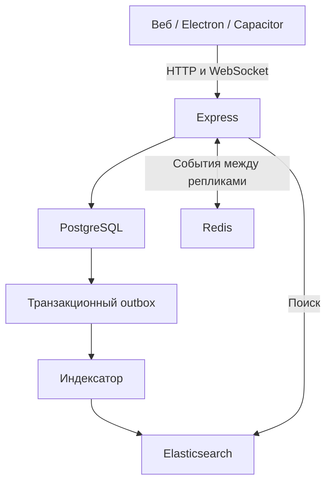

# Архитектура

Браузер, Electron и Capacitor загружают один интерфейс с одного HTTP(S)-origin. Express обслуживает статическую сборку и `/api`; `/ws` использует то же cookie сессии.

## Отправка

1. Клиент генерирует `client_id` и отправляет POST с текстом. Для первого повтора при сетевом сбое ID сохраняется.
2. База атомарно вставляет сообщение и создаёт запись outbox триггером. Уникальность `(user_id, client_id)` обеспечивает идемпотентность.
3. Сервер возвращает сохранённое сообщение и публикует событие через Redis либо в локальные WebSocket.
4. UI объединяет POST-ответ и событие по числовому ID, поэтому сообщение не дублируется.
5. Получение сохранённого POST-ответа не означает, что другой пользователь прочитал сообщение. Двойная галочка в UI означает сохранение на сервере.

Гарантия: подтверждённые сообщения хранятся в SQL. Доставка событий выполняется best effort. Если сервер упал после commit до публикации, сообщение появляется при обновлении/переподключении/загрузке истории. Общая транзакция SQL + Redis не реализована. Клиент после переподключения заново загружает последние 50 сообщений, более старые доступны подгрузкой; не сохраняет потенциально неполный набор страниц до разрыва.

## Данные

- `users`: логин, имя, bio, scrypt-хеш, дата регистрации.
- `sessions`: хеш случайного 256-битного токена, пользователь, срок.
- `channels`: название, описание, автор, дата.
- `messages`: монотонный ID, канал, автор, текст, client ID, дата.
- `search_outbox`: ID сообщения до успешной индексации.
- `schema_migrations`: версия схемы. PostgreSQL-миграции сериализованы advisory lock.

SQLite и PostgreSQL имеют общую схему с разным типом автоинкремента. Для локального SQLite включены WAL, foreign keys и busy timeout; для PostgreSQL используется pool на 20 соединений. Пагинация опирается на индекс `(channel_id,id DESC)` и не использует OFFSET.

## Границы безопасности

React экранирует сообщения, HTML не интерпретируется. Все SQL-параметры связаны отдельно от запросов. Вход/регистрация, общий API и отправка ограничиваются rate limiter. WebSocket принимает только существующую сессию, проверяет Origin при его наличии, ограничивает подключения пользователя и размер кадра; медленные клиенты отключаются. Heartbeat проверяет срок и отзыв сессии. Cookie защищены от JS через HttpOnly. HTTP-мутации проверяют Origin, SameSite блокирует обычные межсайтовые POST с cookie.

Все аутентифицированные пользователи видят все каналы — отдельной модели членства нет. Регистрация открыта. Нет E2E-шифрования, восстановления пароля, удаления аккаунта или админ-панели. Для публичного сервиса нужны TLS, управление регистрацией, модерация и политика хранения.

## Рост

PostgreSQL + Redis позволяют вынести API в несколько процессов за reverse proxy. Счётчики лимитов нужно перенести в Redis. Для устойчивого воспроизведения всех событий вместо Pub/Sub потребуются Redis Streams либо отдельный event outbox с подтверждениями. Для каналов с десятками тысяч подписчиков нужна подписка WS только на выбранные каналы; текущая версия передаёт все публичные сообщения каждому подключению.
